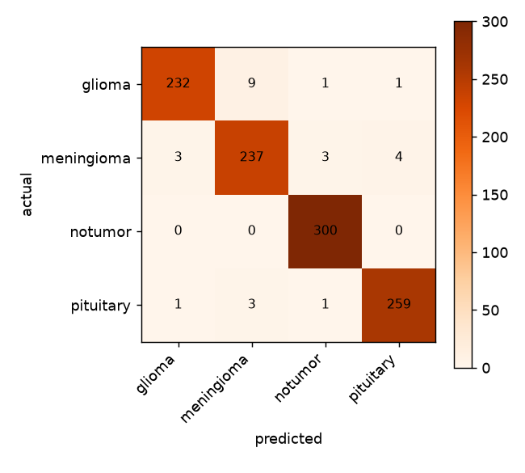
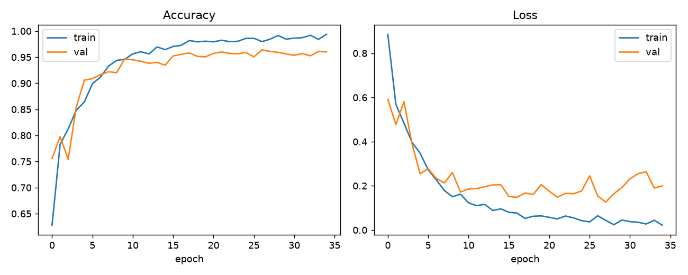

# Brain Tumor MRI Classifier

A convolutional neural network, trained from scratch, that classifies brain MRI scans
into four categories: **glioma**, **meningioma**, **pituitary tumor**, or **no tumor**.
It comes with a results dashboard and a "try it" page where you upload a scan and get a
live prediction.

**Live site:** https://jayasaikishore-brain-tumor-classifier.static.hf.space
(the model runs in your browser; uploaded scans never leave your device)

> **Educational project only — not a diagnostic tool.** Do not use this for real medical
> decisions. See [Limitations](#limitations--disclaimer).

**Test accuracy: 97.53%** on a held-out set of 1,054 images.



---

## Table of contents

- [Dataset](#dataset)
- [Architecture](#architecture)
- [Training setup](#training-setup)
- [Results](#results)
- [Transfer learning experiments](#transfer-learning-experiments-efficientnetb0-and-resnet-50)
- [The site and the app](#the-site-and-the-app)
- [Project structure](#project-structure)
- [Running it yourself](#running-it-yourself)
- [Deployment](#deployment-hugging-face-static-space-free)
- [Making changes](#making-changes)
- [Limitations & disclaimer](#limitations--disclaimer)
- [Possible improvements](#possible-improvements)

---

## Dataset

[`Hemg/Brain-Tumor-MRI-Dataset`](https://huggingface.co/datasets/Hemg/Brain-Tumor-MRI-Dataset)
on Hugging Face — a combination of the **Figshare**, **SARTAJ**, and **Br35H** brain MRI
datasets, repackaged as a single Parquet file. No account or API key required to download it.

| | |
|---|---|
| Total images | 7,023 |
| Classes | glioma, meningioma, pituitary tumor, no tumor |
| Format | single Parquet file, `image` (JPEG bytes) + `label` (int 0–3) columns |
| Size | ~155 MB |

The raw dataset isn't committed to this repo (~155 MB — over GitHub's 100MB file limit, and
it's a third-party dataset rather than project source). `src/train.py` expects it at
`data/brain_tumor.parquet` — see [Running it yourself](#running-it-yourself) for the
download command.

The script splits it **70% train / 15% validation / 15% test**, stratified by class, so
every split has a proportional mix of all four labels. The split uses a fixed seed and
is identical for every architecture and input size, so results are directly comparable.

## Architecture

A small CNN built with `tf.keras.Sequential` — four convolution/pooling blocks that
progressively extract and downsample features, followed by a dense classification head.

```
Input            128 x 128 x 3  (RGB MRI slice)
  │
RandomRotation   ±0.02 turns (~±7°)        \
RandomZoom       ±5%                        > training only — identity at inference
RandomBrightness ±5%                       /
  │
Rescaling        scales pixel values from [0, 255] to [0, 1]
  │
Conv2D  32 filters, 3x3, ReLU, same padding
MaxPool 2x2                              →  64 x  64 x  32
  │
Conv2D  64 filters, 3x3, ReLU, same padding
MaxPool 2x2                              →  32 x  32 x  64
  │
Conv2D 128 filters, 3x3, ReLU, same padding
MaxPool 2x2                              →  16 x  16 x 128
  │
Conv2D 128 filters, 3x3, ReLU, same padding
MaxPool 2x2                              →   8 x   8 x 128
  │
Flatten                                  →  8,192
Dense   128, ReLU
Dropout 0.5                              (regularization — the dataset is small for a CNN
  │                                        trained from scratch, dropout reduces overfitting)
Dense   4, Softmax                       →  P(glioma), P(meningioma), P(notumor), P(pituitary)
```

**Why this shape:**
- **Four conv/pool blocks** is enough depth for a 128×128 input to reduce down to an 8×8
  feature map by the end — each block halves the spatial resolution while doubling (then
  holding) the filter count, a standard "get smaller and deeper" CNN pattern.
- **`same` padding** keeps the conv layers from shrinking the feature map on their own,
  so `MaxPooling2D` is the only thing changing resolution — makes the shape math easy to
  reason about.
- **Augmentation layers (`RandomRotation`/`RandomZoom`/`RandomBrightness`), kept deliberately
  mild** — see [Results](#results) for why. They're real Keras layers inside the model
  (not a separate preprocessing step), so Keras automatically disables them outside of
  `model.fit()` — the exact same saved model does inference with no augmentation applied.
- **`Rescaling` as the first non-augmentation layer** (rather than normalizing the numpy
  arrays before training) means the saved model accepts raw `0–255` pixels directly — the
  same preprocessing path is used in training, in the Flask app and in the browser, so
  there's no train/serve skew.
- **Dropout(0.5)** before the final layer, because 4,916 training images is a modest
  dataset for a CNN trained from scratch (no pretrained weights) — the model memorizes
  the training set quickly if not regularized.
- **1.29M parameters total** — small enough to train in well under half an hour on a
  CPU, no GPU required.

Total params: **1,290,052** (4.92 MB).

## Training setup

| | |
|---|---|
| Framework | TensorFlow / Keras |
| Image size | 128 × 128, RGB (resized with Pillow's bicubic filter) |
| Augmentation | ±7° rotation, ±5% zoom, ±5% brightness (training only) |
| Batch size | 32 |
| Optimizer | Adam |
| Loss | sparse categorical crossentropy |
| Max epochs | 35 |
| Early stopping | monitors `val_accuracy`, patience 8, restores best weights |
| Checkpointing | best `val_accuracy` epoch saved to disk after every improvement |

Early stopping and checkpointing both matter here in practice, not just as best
practice: the training run checkpoints the best model to disk after every epoch that
improves validation accuracy, so even if the process is interrupted mid-run, the best
model so far is never lost. Per-epoch history is saved too, so an interrupted run can be
resumed (`--resume`, see below).

## Results

**Test set: 1,054 images, 97.53% accuracy, 0.085 loss.** Ran the full 35 epochs; the
best validation epoch (27, 96.4% val accuracy) was restored automatically at the end.

| Class | Precision | Recall | F1 | Support |
|---|---|---|---|---|
| glioma | 98.3% | 95.5% | 96.9% | 243 |
| meningioma | 95.2% | 96.0% | 95.6% | 247 |
| notumor | 98.4% | 100.0% | 99.2% | 300 |
| pituitary | 98.1% | 98.1% | 98.1% | 264 |

Meningioma is still the weakest class (as it was before augmentation), and the most common
error is a glioma predicted as meningioma (9 of 243 gliomas).

The dashboard's 12 sample predictions are computed on the exact JPEG images shown, so
each one matches what you get when you upload that picture yourself.

### The augmentation tuning story

Adding augmentation wasn't a straightforward win on the first try, and it's worth
documenting why, since "add augmentation" doesn't automatically mean "model gets better":

| Attempt | Rotation / Zoom / Brightness | Patience / max epochs | Test accuracy | Meningioma F1 |
|---|---|---|---|---|
| Baseline (no augmentation) | — | 4 / 20 | 95.83% | 91.6% |
| v1 | ±18° / ±10% / ±15% | 4 / 20 | 92.50% | 85.0% |
| v2 (same augmentation, more patience) | ±18° / ±10% / ±15% | 8 / 35 | 92.50% | 85.0% |
| v3 (gentler augmentation) | ±7° / ±5% / ±5% | 8 / 35 | 97.15% | 94.3% |
| **v3 retrain (same config, current model)** | **±7° / ±5% / ±5%** | **8 / 35** | **97.53%** | **95.6%** |

v1 made things *worse*. The first instinct was "it just needs more time to converge
under the harder augmented training signal," so v2 reran with double the patience and
nearly double the epoch budget — and converged to the exact same result, which ruled
that theory out. The actual issue was the augmentation strength itself: rotation/zoom/
brightness are usually nuisance variation in natural photos, but MRI orientation and
intensity carry real diagnostic signal, and meningiomas in particular are often small,
peripheral masses — a ±18° rotation or ±10% zoom can distort or crop the exact region
the model needs most for the hardest class. Turning all three down to roughly a third of
their original strength (v3) is what actually helped.

The v3 retrain uses the identical model and augmentation settings, rerun after a code
cleanup (no change to the architecture, data split or hyperparameters). The ~0.4-point
difference from the first v3 run is ordinary run-to-run variation in CNN training on CPU,
not an improvement from any change — worth keeping in mind when comparing single runs.



## Transfer learning experiments (EfficientNetB0 and ResNet-50)

Two ImageNet-pretrained models were trained on the **same** 70/15/15 split as the CNN,
each in two phases: first the classification head on backbone features computed once,
then fine-tuning the top of the backbone with BatchNorm frozen.

- **EfficientNetB0** (`--arch efficientnet`): 160×160 input, blocks 6–7 fine-tuned.
- **ResNet-50** (`--arch resnet50`): 224×224 input (its ImageNet resolution), the last
  stage (`conv5`) fine-tuned. ResNet-50 has no built-in input scaling, so the model
  includes a `ResNetPreprocess` layer and still takes raw 0–255 pixels like the others.

| | Input | Parameters | Validation acc. | Test acc. | Test loss | glioma F1 | meningioma F1 | notumor F1 | pituitary F1 |
|---|---|---|---|---|---|---|---|---|---|
| **CNN (current model)** | 128 | **1.3 M** | 96.4% | **97.53%** | **0.085** | 96.9% | **95.6%** | 99.2% | **98.1%** |
| ResNet-50 | 224 | 23.6 M | **98.01%** | 97.06% | 0.134 | **97.1%** | 94.4% | **99.3%** | 96.9% |
| EfficientNetB0 | 160 | 4.1 M | 96.96% | 96.77% | 0.149 | 95.4% | 94.5% | **99.5%** | 97.0% |

**Neither was adopted.** All three models land within 0.8 points of each other on the
test set, a gap of about 5–8 images out of 1,054, which is within run-to-run noise. The
CNN is the smallest (18× fewer parameters than ResNet-50), has the lowest test loss, and
runs comfortably in the browser, so it stays.

What the comparison shows:
- **ResNet-50 is best on validation (98.0%) but not on test (97.1%).** Validation
  accuracy is used to pick its best epoch, so it is slightly optimistic; the test set is
  the fair score.
- **ResNet-50's weak spot is meningioma.** It sends 13 of 247 meningiomas to pituitary
  (meningioma recall 91.9%, versus 96.0% for the CNN), while it is the best of the three
  on glioma (236 of 243 correct).
- **Fine-tuning started to overfit.** By the end of ResNet-50's fine-tuning, training
  accuracy was 99.8% while validation accuracy moved between 92% and 98%. Early stopping
  ended the run after 21 of 25 epochs and restored the best epoch.
- **Cost.** On a CPU-only Windows laptop (TensorFlow has no GPU support on native
  Windows), ResNet-50's fine-tuning took about 6 minutes per epoch, roughly 2 hours in
  total, compared with 15–20 minutes for the whole CNN training.

The EfficientNet run used 160×160 to fit in memory, below its 224×224 ImageNet
resolution, so a 224×224 rerun would make the three-way comparison fairer.

### Grad-CAM heatmaps

The app supports Grad-CAM heatmaps ("where the model looked") on both prediction pages
and in the API, for models that end in GlobalAveragePooling → Dense — like the
EfficientNet and ResNet-50 ones. For that head, Grad-CAM equals `feature_map @ dense_weights`, so it
needs no gradients: the exported ONNX model computes it as a second output (`cam`) and
the browser draws it. `tests/test_gradcam.py` checks this against a real gradient
computation (max difference ~2e-7 on the sample images).

**The current CNN doesn't have that head, so no heatmap is shown** on the live site and
those tests are skipped. Switching to one of the transfer-learning models would turn
heatmaps on.

## The site and the app

There are two ways to serve the project, sharing the same templates, styles and model:

**1. The public static site** (what's live). A static Hugging Face Space with the
results dashboard and a "try it" page that runs the model **in the visitor's browser**
with [ONNX Runtime Web](https://onnxruntime.ai/). No server: free, no cold start, and
uploaded scans never leave the device. Built by `scripts/build_static.py`; see
[Deployment](#deployment-hugging-face-static-space-free).

**2. The Flask app** (`web/app.py`), to run locally or anywhere Docker runs:

- **`/`** — reads `model/metrics.json` and `web/static/results/samples.json` fresh on
  every request, so the dashboard always reflects the most recent training run: stat
  cards, training curves, confusion matrix, per-class table, and 12 labeled sample
  predictions from the test set.
- **`/predict`** — upload an image; it's resized to the model's own input size (128×128
  for the CNN) with the same Pillow resize as training, and the page shows the predicted
  class plus a confidence breakdown (and a Grad-CAM heatmap for models that support it).
  Uploads are never written to disk; the preview is sent back inline. Files over 8 MB get
  a friendly error.
- **`/api/predict`** — the same prediction as JSON, for scripts and agents (below).
- **`/healthz`** — readiness check: 503 while the model is loading, 200 once it can serve
  predictions.

The model and class names are loaded lazily and cached in memory, keyed on file
modification time, so after a retrain the next request picks up the new model without a
restart. Class names have a single source: `src/train.py` reads them from the dataset's
own label metadata and writes `model/class_names.json`. If no model has been trained
yet, the pages say so instead of erroring.

### JSON API (Flask app only)

Not available on the static site, which has no server.

```bash
curl -F image=@scan.jpg http://127.0.0.1:5500/api/predict
```

Real response from the current model, for one of the dashboard samples:

```json
{
  "label": "meningioma",
  "confidence": 0.98898,
  "probabilities": {"glioma": 0.003158, "meningioma": 0.98898, "notumor": 0.007346, "pituitary": 0.000517},
  "heatmap": null,
  "model": {"arch": "cnn", "input_size": 128, "test_accuracy": 0.9753},
  "disclaimer": "Educational project only. Not a diagnostic tool; not for medical decisions."
}
```

Probabilities are 0–1, not percentages. `heatmap` is `null` for the CNN; with a
Grad-CAM-capable model it's `{"class": ..., "grid": [[...], ...]}`, the map for the
predicted class over the whole image (rows top to bottom, values 0–1). Errors return
`{"error": "..."}` with status 400 (no file / not an image), 413 (over 8 MB) or 503 (no
trained model).

## Project structure

```
brain-tumor-classifier/
├── data/
│   └── brain_tumor.parquet       # downloaded dataset (gitignored, see below)
├── src/
│   └── train.py                  # loads data, trains (--arch cnn|efficientnet|resnet50), saves everything
├── model/
│   ├── brain_tumor_cnn.keras     # trained model
│   ├── brain_tumor_cnn.onnx      # same model for the browser (written by train.py)
│   ├── class_names.json
│   └── metrics.json              # accuracy, per-class report, confusion matrix
├── web/
│   ├── app.py                    # Flask app + JSON API (+ dev server)
│   ├── serve.py                  # production server (waitress)
│   ├── templates/
│   │   ├── base.html
│   │   ├── index.html            # results dashboard (both versions)
│   │   ├── predict.html          # upload + prediction (Flask)
│   │   └── predict_static.html   # upload + in-browser prediction (static site)
│   └── static/
│       ├── style.css
│       ├── js/                   # in-browser prediction + Pillow-identical resize
│       └── results/              # plots + sample predictions (written by train.py)
├── scripts/
│   ├── export_onnx.py            # Keras -> ONNX, verified to match
│   ├── build_static.py           # builds the static site into build/static_site/
│   ├── deploy_hf.py              # deploys it to the Hugging Face Space, then verifies
│   ├── smoke_check.py            # live site up, right model served
│   └── browser_check.py          # real in-browser predictions (headless Chromium)
├── tests/                        # pytest: routes, API, model gate, ONNX parity, Grad-CAM,
│                                 #   JS resize vs Pillow, static build, Space config
├── deploy/huggingface/README.md  # Space config (becomes the Space's README.md)
├── .github/workflows/
│   ├── ci.yml                    # every PR + main: lint, tests, build, browser test, server
│   └── monitor.yml               # every 6 h: checks the live site
├── Dockerfile                    # self-hosting the Flask server version
├── requirements.txt              # pinned runtime + training deps
├── requirements-dev.txt          # + pytest, ruff, huggingface_hub, playwright
└── README.md
```

## Running it yourself

Requires Python 3.13 (`.python-version`) and the exact versions pinned in
`requirements.txt`. The committed model was saved with Keras 3.15.1 and won't load on
older Keras versions; every dependency is pinned so a fresh install next month gets the
same stack. Upgrade deliberately: bump a version, run the tests, commit.

```bash
pip install -r requirements-dev.txt     # runtime + training + dev tools
python -m playwright install chromium   # only for scripts/browser_check.py

# 1. Download the dataset (no auth needed, ~155MB)
mkdir -p data
curl -L -o data/brain_tumor.parquet \
  https://huggingface.co/datasets/Hemg/Brain-Tumor-MRI-Dataset/resolve/main/data/train-00000-of-00001.parquet

# 2. Train the CNN (~15-20 min on CPU). Writes model/ and web/static/results/,
#    then exports and verifies the browser (ONNX) model.
python src/train.py

# 3. Run the Flask app
cd web
python app.py
# -> http://localhost:5500
```

The Flask debugger is off by default because it allows running arbitrary code from the
browser. For local development only, set `FLASK_DEBUG=1` before `python app.py`.

### Training options

```bash
python src/train.py --arch efficientnet --out build/experiments/effnet
#   experiment: writes to the --out folder, never touches model/ or the site
python src/train.py --arch efficientnet --out build/experiments/effnet --resume 11 --batch-size 16
#   continue an interrupted run from its best checkpoint, with less memory
python src/train.py --arch resnet50 --out build/experiments/resnet50
#   ResNet-50 experiment at 224x224 (--resume works the same way)
```

EfficientNet and ResNet-50 need a few GB of free RAM; on a machine where memory runs out,
use `--batch-size 16` and close other heavy apps. ResNet-50 is the slowest: about 2 hours
on a CPU. Always pass `--out` for experiments; without it, the script writes to `model/`
and replaces the deployed CNN.

### Tests and checks

```bash
ruff check . && ruff format --check .   # lint + formatting
pytest                                  # full test suite
```

What the tests guard:
- **Model release gate** (`tests/test_model.py`): fails if test accuracy drops below 95%
  (or any class F1 below 90%), or if the committed model no longer reproduces the
  dashboard's 12 sample predictions (labels and confidences) — what a bad retrain or a
  behaviour-changing dependency upgrade looks like.
- **Browser model** (`tests/test_static_site.py`): the ONNX model matches Keras, and the
  static build has no broken links.
- **Browser preprocessing** (`tests/test_preprocess_js.py`, needs Node): the JavaScript
  resize matches Pillow pixel for pixel.
- **App and API** (`tests/test_app.py`), **Grad-CAM** (`tests/test_gradcam.py`),
  **Space config** (`tests/test_deploy_config.py`).

CI (`.github/workflows/ci.yml`) runs all of this on every pull request and on `main`,
then builds the static site, classifies samples in a real headless browser, and starts
the production server and waits for `/healthz` to return 200.

### Production server

`python app.py` is Flask's development server. For production use:

```bash
python web/serve.py      # waitress, 0.0.0.0:7860 by default
```

The model loads in a background thread at startup (20–60 s cold); `/healthz` returns
503 until it's ready, then 200. The `Dockerfile` packages this for any Docker host:
`docker build -t brain-tumor-classifier . && docker run -p 7860:7860 brain-tumor-classifier`.

### Environment variables

| Variable | Used by | Default | Purpose |
|---|---|---|---|
| `FLASK_DEBUG` | `app.py` (dev) | off | `1` enables the Werkzeug debugger. **Never in production.** |
| `HOST` | `app.py`, `serve.py` | `127.0.0.1` (dev) / `0.0.0.0` (prod) | Interface to bind |
| `PORT` | `app.py`, `serve.py` | `5500` (dev) / `7860` (prod) | Port to listen on |
| `THREADS` | `serve.py` | `4` | waitress worker threads |
| `TF_CPP_MIN_LOG_LEVEL` | TensorFlow | `0` (`2` in Docker) | Quiets TensorFlow's startup logging |
| `HF_SPACE_ID` | deploy/check scripts | `JayaSaiKishore/brain-tumor-classifier` | Which Space to deploy to / check |

No secrets are needed to run the app. Deploying needs a Hugging Face login
(`hf auth login`), stored locally by the `hf` CLI, never in the repo.

## Deployment (Hugging Face static Space, free)

The public site is a free **static** Hugging Face Space. (Docker and Gradio Spaces, which
could run the Flask server, need a paid plan on free Hugging Face accounts.)

How the browser version stays faithful to the trained model:
- `scripts/export_onnx.py` converts the Keras model to `model/brain_tumor_cnn.onnx` and
  refuses to write it unless it matches Keras (max probability difference ~4e-7, same
  labels). `src/train.py` runs it automatically at the end of training, and
  `tests/test_static_site.py` fails if the two models ever disagree.
- `web/static/js/preprocess.js` is a port of Pillow's bicubic resize, and images are
  decoded with the browser's `ImageDecoder`, so the browser feeds the model exactly the
  pixels Python would. Verified in Chrome on 30 original-size dataset scans (JPEG + PNG,
  grayscale + colour): 30/30 pixel-identical model inputs and identical predictions.
- `scripts/build_static.py` renders the dashboard with the real Flask templates, so the
  two versions can't drift apart.

```bash
hf auth login                              # once; token needs write access
python scripts/deploy_hf.py --dry-run      # build + show what would change
python scripts/deploy_hf.py                # lint + tests, build, upload, verify live
```

`deploy_hf.py` only deploys a clean, committed tree, records the git commit in the
Space's commit message, removes files that aren't part of the release (so the Space
mirrors exactly one commit), and refuses non-static Spaces. First deploy to a new
Space: add `--create`. After uploading it verifies the live site and prints rollback
steps if anything fails:
- `scripts/smoke_check.py`: site up, dashboard shows this model, every file served,
  live ONNX model byte-identical to the committed one.
- `scripts/browser_check.py`: headless Chromium opens the "try it" page, classifies
  three dashboard samples (expects the same labels and confidences, ±0.02%), checks a
  non-image upload gets the friendly error, and fails on any JavaScript error.

Preview locally: `python scripts/build_static.py`, then
`python -m http.server 8000 --directory build/static_site` and
`python scripts/browser_check.py http://127.0.0.1:8000`.

### Monitoring

With no server there are no server logs, so the site is monitored the way a visitor
uses it. `.github/workflows/monitor.yml` runs the smoke check and the browser check
against the live Space every 6 hours (or on demand from the Actions tab). GitHub
emails the repo owner when a scheduled run fails. A failure means the site is down,
the page is broken, or the live model differs from `main` (e.g. a retrain merged but not
deployed). Scheduled workflows are disabled by GitHub after 60 days without repository
activity; re-enable from the Actions tab.

### Rolling back

The model is committed alongside the code, so any good commit is a complete, working
version.
- Fastest: `git checkout <good-commit>`, `python scripts/deploy_hf.py --skip-checks`,
  then `git checkout main` (the Space's commit history shows which commit each deploy
  came from).
- Whole release: `git revert <bad-commit>` on a branch, merge it via a pull request, and
  redeploy.
- Model only: `git checkout <good-commit> -- model/ web/static/results/`, commit via a
  pull request, redeploy. Restore both directories together so the dashboard matches the
  model.

## Making changes

`main` is protected: changes go in through a pull request, and the CI **test** check
must pass before merging. Direct pushes and force-pushes to `main` are blocked.

1. `git switch -c my-change`, commit, `git push -u origin my-change`
2. Open a pull request; CI runs lint, tests, the static build, the browser test and the
   server health check.
3. Merge when it's green, then `git switch main && git pull`.
4. Deploy: `python scripts/deploy_hf.py` (verifies the live site afterwards).

## Limitations & disclaimer

- Trained on a relatively small, pre-curated public dataset — not a validated clinical
  tool, and it has no idea what to do with an image that isn't a brain MRI (it will still
  confidently output one of the four classes).
- No cross-dataset validation — since this dataset merges three different sources, there
  may be source-specific visual artifacts the model partly keys off instead of purely
  tumor morphology.
- CPU-only training on 128×128 images trades off some resolution/detail for speed.
  Transfer learning (EfficientNetB0 at 160×160 and ResNet-50 at 224×224, top layers
  fine-tuned) did not improve on it, including on meningioma; see the
  [experiments](#transfer-learning-experiments-efficientnetb0-and-resnet-50).
- A single train/val/test split: differences of a few tenths of a percent between runs
  or models are within noise.

## Possible improvements

- EfficientNetB0 at its full 224×224 resolution, and deeper fine-tuning of both
  pretrained models, given more memory or a GPU
- k-fold cross-validation instead of a single train/val/test split, to tell real
  improvements from noise
- Cross-dataset validation: train on some of the three source datasets, test on another
- Out-of-distribution detection, so non-MRI uploads are flagged instead of classified
