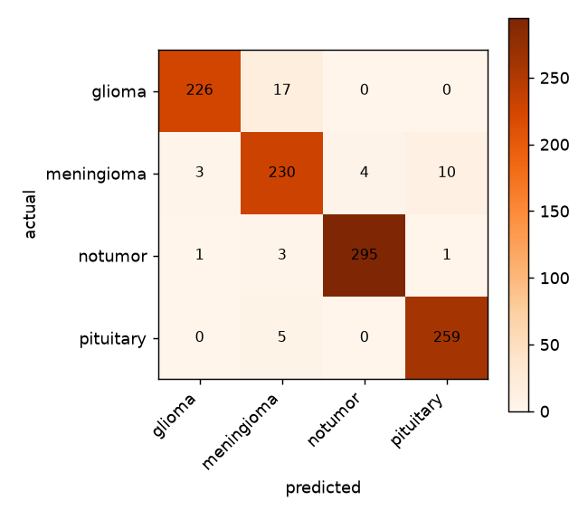
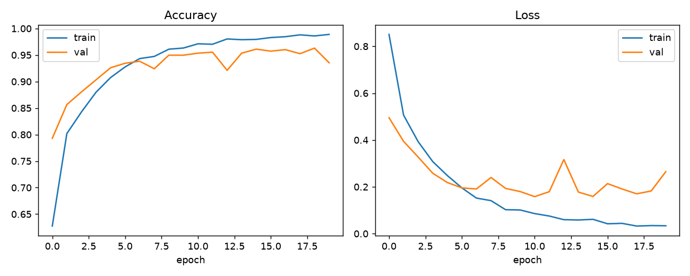

# Brain Tumor MRI Classifier

A basic convolutional neural network, trained from scratch (no transfer learning), that
classifies brain MRI scans into four categories — **glioma**, **meningioma**, **pituitary
tumor**, or **no tumor**. Includes a Flask website that displays the full training report
and lets you upload an MRI image for a live prediction.

> **Educational project only — not a diagnostic tool.** Do not use this for real medical
> decisions. See [Limitations](#limitations--disclaimer).

**Test accuracy: 97.15%** on a held-out set of 1,054 images.



---

## Table of contents

- [Dataset](#dataset)
- [Architecture](#architecture)
- [Training setup](#training-setup)
- [Results](#results)
- [Web app](#web-app)
- [Project structure](#project-structure)
- [Running it yourself](#running-it-yourself)
- [Limitations & disclaimer](#limitations--disclaimer)
- [Possible improvements](#possible-improvements)

---

## Dataset

[`Hemg/Brain-Tumor-MRI-Dataset`](https://huggingface.co/datasets/Hemg/Brain-Tumor-MRI-Dataset)
on Hugging Face — a combination of the **Figshare**, **SARTAJ**, and **Br35H** brain MRI
datasets, repackaged as a single Parquet files. No account or API key required to download it.

| | |
|---|---|
| Total images | 7,023 |
| Classes | glioma, meningioma, pituitary tumor, no tumor |
| Format | single Parquet file, `image` (JPEG bytes) + `label` (int 0–3) columns |
| Size | ~155 MB |

The raw dataset isn't committed to this repo (148MB — over GitHub's 100MB file limit, and
it's a third-party dataset rather than project source). `src/train.py` expects it at
`data/brain_tumor.parquet` — see [Running it yourself](#running-it-yourself) for the
download command.

The script splits it **70% train / 15% validation / 15% test**, stratified by class, so
every split has a proportional mix of all four labels.

## Architecture

A small CNN built with `tf.keras.Sequential` — four convolution/pooling blocks that
progressively extract and downsample features, followed by a dense classification head.

```
Input            128 x 128 x 3  (RGB MRI slice)
  │
RandomRotation   ±0.02 turns (~±7°)        \
RandomZoom       ±5%                        > training only — identity at inference
RandomBrightness ±5%                       /
  │
Rescaling        scales pixel values from [0, 255] to [0, 1]
  │
Conv2D  32 filters, 3x3, ReLU, same padding
MaxPool 2x2                              →  64 x  64 x  32
  │
Conv2D  64 filters, 3x3, ReLU, same padding
MaxPool 2x2                              →  32 x  32 x  64
  │
Conv2D 128 filters, 3x3, ReLU, same padding
MaxPool 2x2                              →  16 x  16 x 128
  │
Conv2D 128 filters, 3x3, ReLU, same padding
MaxPool 2x2                              →   8 x   8 x 128
  │
Flatten                                  →  8,192
Dense   128, ReLU
Dropout 0.5                              (regularization — the dataset is small for a CNN
  │                                        trained from scratch, dropout reduces overfitting)
Dense   4, Softmax                       →  P(glioma), P(meningioma), P(notumor), P(pituitary)
```

**Why this shape:**
- **Four conv/pool blocks** is enough depth for a 128×128 input to reduce down to an 8×8
  feature map by the end — each block halves the spatial resolution while doubling (then
  holding) the filter count, a standard "get smaller and deeper" CNN pattern.
- **`same` padding** keeps the conv layers from shrinking the feature map on their own,
  so `MaxPooling2D` is the only thing changing resolution — makes the shape math easy to
  reason about.
- **Augmentation layers (`RandomRotation`/`RandomZoom`/`RandomBrightness`), kept deliberately
  mild** — see [Results](#results) for why. They're real Keras layers inside the model
  (not a separate preprocessing step), so Keras automatically disables them outside of
  `model.fit()` — the exact same saved model does inference with no augmentation applied,
  no special-casing needed in the Flask app.
- **`Rescaling` as the first non-augmentation layer** (rather than normalizing the numpy
  arrays before training) means the saved model accepts raw `0–255` uint8 images directly
  — the exact same preprocessing path is used during training and in the Flask `/predict`
  endpoint, so there's no risk of train/serve skew.
- **Dropout(0.5)** before the final layer, because 4,916 training images is a modest
  dataset for a CNN trained from scratch (no pretrained weights) — the model memorizes
  the training set quickly if not regularized.
- **1.29M parameters total** — small enough to train in well under half an hour on a
  CPU, no GPU required.

Total params: **1,290,052** (4.92 MB).

## Training setup

| | |
|---|---|
| Framework | TensorFlow / Keras |
| Image size | 128 × 128, RGB |
| Augmentation | ±7° rotation, ±5% zoom, ±5% brightness (training only) |
| Batch size | 32 |
| Optimizer | Adam |
| Loss | sparse categorical crossentropy |
| Max epochs | 35 |
| Early stopping | monitors `val_accuracy`, patience 8, restores best weights |
| Checkpointing | best `val_accuracy` epoch saved to disk after every improvement |

Early stopping and checkpointing both matter here in practice, not just as best
practice: the training run checkpoints the best model to disk after every epoch that
improves validation accuracy, so even if the process is interrupted mid-run, the best
model so far is never lost.

## Results

**Test set: 1,054 images, 97.15% accuracy, 0.149 loss.** Ran 32 of 35 max epochs before
early stopping (patience 8) ended it; best epoch restored automatically.

| Class | Precision | Recall | F1 | Support |
|---|---|---|---|---|
| glioma | 99.1% | 95.1% | 97.1% | 243 |
| meningioma | 94.3% | 94.3% | 94.3% | 247 |
| notumor | 98.0% | 99.3% | 98.7% | 300 |
| pituitary | 97.0% | 99.2% | 98.1% | 264 |

Meningioma is still the weakest class (same as before augmentation), but every single
class improved — this wasn't a trade-off against the other three.

### The augmentation tuning story

Adding augmentation wasn't a straightforward win on the first try, and it's worth
documenting why, since "add augmentation" doesn't automatically mean "model gets better":

| Attempt | Rotation / Zoom / Brightness | Patience / max epochs | Test accuracy | Meningioma F1 |
|---|---|---|---|---|
| Baseline (no augmentation) | — | 4 / 20 | 95.83% | 91.6% |
| v1 | ±18° / ±10% / ±15% | 4 / 20 | 92.50% | 85.0% |
| v2 (same augmentation, more patience) | ±18° / ±10% / ±15% | 8 / 35 | 92.50% | 85.0% |
| **v3 (gentler augmentation)** | **±7° / ±5% / ±5%** | **8 / 35** | **97.15%** | **94.3%** |

v1 made things *worse*. The first instinct was "it just needs more time to converge
under the harder augmented training signal," so v2 reran with double the patience and
nearly double the epoch budget — and converged to the exact same result, which ruled
that theory out. The actual issue was the augmentation strength itself: rotation/zoom/
brightness are usually nuisance variation in natural photos, but MRI orientation and
intensity carry real diagnostic signal, and meningiomas in particular are often small,
peripheral masses — a ±18° rotation or ±10% zoom can distort or crop the exact region
the model needs most for the hardest class. Turning all three down to roughly a third of
their original strength (v3) is what actually helped.



## Web app

A small Flask app (`web/app.py`) with two routes:

- **`/`** — reads `model/metrics.json` and `web/static/results/samples.json` fresh on
  every request (no caching), so the dashboard always reflects whatever the most recent
  training run produced. Renders the stat cards, the training curve and confusion matrix
  images, the per-class table, and a gallery of 12 labeled sample predictions from the
  test set.
- **`/predict`** — accepts an uploaded image, runs it through the *exact* same
  preprocessing as training (resize to 128×128, RGB, let the model's own `Rescaling`
  layer handle normalization), and renders the predicted class plus a confidence
  breakdown across all four classes. The trained model is loaded lazily on first request
  and cached in memory afterward.

Both routes degrade gracefully if `src/train.py` hasn't been run yet — the dashboard
shows a "still training" message instead of erroring, and `/predict` tells you the model
isn't ready rather than crashing.

## Project structure

```
brain-tumor-classifier/
├── data/
│   └── brain_tumor.parquet       # downloaded dataset (gitignored, see below)
├── src/
│   └── train.py                  # loads data, builds + trains the CNN, saves everything
├── model/
│   ├── brain_tumor_cnn.keras     # trained model
│   ├── class_names.json
│   └── metrics.json              # accuracy, per-class report, confusion matrix
├── web/
│   ├── app.py                    # Flask app
│   ├── templates/
│   │   ├── base.html
│   │   ├── index.html            # results dashboard
│   │   └── predict.html          # upload + live prediction
│   └── static/
│       ├── style.css
│       ├── results/              # plots + sample predictions (written by train.py)
│       └── uploads/              # live /predict uploads (gitignored)
├── requirements.txt
└── README.md
```

## Running it yourself

Requires Python 3.10+ and the packages in `requirements.txt` (TensorFlow, scikit-learn,
pandas, pyarrow, Pillow, matplotlib, Flask).

```bash
pip install -r requirements.txt

# 1. Download the dataset (no auth needed, ~155MB)
mkdir -p data
curl -L -o data/brain_tumor.parquet \
  https://huggingface.co/datasets/Hemg/Brain-Tumor-MRI-Dataset/resolve/main/data/train-00000-of-00001.parquet

# 2. Train (takes ~15-20 min on CPU; outputs go to model/ and web/static/results/)
python src/train.py

# 3. Run the site
cd web
python app.py
# -> http://localhost:5500
```

## Limitations & disclaimer

- Trained on a relatively small, pre-curated public dataset — not a validated clinical
  tool, and it has no idea what to do with an image that isn't a brain MRI (it will still
  confidently output one of the four classes).
- No cross-dataset validation — since this dataset merges three different sources, there
  may be source-specific visual artifacts the model partly keys off instead of purely
  tumor morphology.
- CPU-only training on 128×128 images trades off some resolution/detail for speed; a
  higher input resolution or transfer learning from a pretrained vision model would
  likely close most of the remaining gap on meningioma.

## Possible improvements

- Transfer learning from a pretrained backbone (e.g. EfficientNet, ResNet)
- Grad-CAM visualization to show which region of the MRI drove each prediction
- k-fold cross-validation instead of a single train/val/test split
